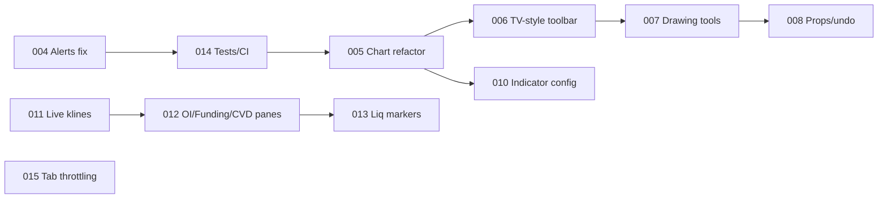

# Advisory — Next Updates & TradingView Toolbars

**Date:** 2026-11-02 · **Baseline:** `46eb03a` (v0.1.6, specs 000–003 done)

---

## Part A — Review of specs 000–003

All four landed cleanly. Render counts for `Home` went from about 200 to 0 per 10s.
Small follow-ups, to fold into the next spec that touches these files:

| File | Note | Severity |
|------|------|----------|
| `lib/marketStore.ts` `scheduleNotify` | The SSR `else if (… && !dirty)` branch can never run, because `dirty` was just set to `true`. Harmless (no listeners on the server) but dead code. Delete it. | Low |
| `lib/marketStore.ts` `useMarket` | The cached snapshot is keyed on the state reference only. If a component passes a selector that depends on **props** (e.g. `s => s.venues[i]`), a prop change won't re-select until the next store write. Also include the selector in the cache key (or document "selectors must be prop-free"). | Low |
| `hooks/useAlerts.ts` | **Real bug, pre-existing:** alerts ignore `alert.symbol`. They are checked against the **currently selected** symbol's price. Set "BTC below 70 000", switch to SOL (~$200), and the alert fires immediately. Alerts on non-selected symbols can never fire correctly. → **Spec 004**. | **High** |

---

## Part B — Can you use the full TradingView toolbars?

TradingView offers three products. Only one is actually open to this project as it
stands today.

| Option | What you get | Cost / licence | Fit for YMC |
|--------|--------------|----------------|-------------|
| **Lightweight Charts** (current) | Canvas chart engine, **no toolbars**. You build all UI. | Free, Apache-2.0, public-repo OK | ✅ Already in use |
| **Advanced Real-Time Chart widget** (iframe embed) | The full TradingView UI: left drawing rail, 100+ indicators, timeframe/chart-type menus | Free, keyless, TradingView branding | ⚠️ Possible, but you lose control (see below) |
| **Advanced Charts library** (self-hosted, `charting_library`) | The same full UI, fed by **your** data via a JS datafeed | Free **only** for companies with a live public product, **application + approval** required, proprietary, **must not be in a public repo** | ❌ Blocked today |
| **Trading Platform** | Advanced Charts + trading UI | Paid licence | ❌ Overkill, no order entry here |

### Why Advanced Charts is blocked
1. **Your repo is public and GPL-3.0.** TradingView forbids putting library files in a
   public repo. A proprietary component in a GPL app also needs a licence exception
   from you.
2. **Approval** is for registered companies with a live public product. Personal
   and hobby projects are routinely declined.
3. If both change (private repo or build-time download from TradingView's private
   GitHub, plus approval granted), it's actually a good technical fit: `getBars` →
   `/api/klines`, `subscribeBars` → `marketStore`. Keep this as a future option.

### What the free widget costs you
The widget shows TradingView's own data feed and UI inside an iframe. You can't
reach inside it, so you would lose:
- Your drawings (persisted per symbol), magnet, ruler, ✕ delete UX
- RSI/MACD/Stoch sub-panes with your theme, session H/L, UTC day lines
- Theme sync (only light/dark + a few colour overrides)
- Hotkeys (`[` `]` `1`–`0` `v` `d` `m`): the iframe swallows focus, and symbol/TF
  changes need a full widget reload
- PNG/CSV export, and future features like liquidation markers or OI/funding panes
- XAU/XAG/OIL mapping: TradingView uses different tickers (e.g. `BINANCE:XAUUSDT.P`
  may or may not exist; verify per symbol)

### Recommendation
**Keep lightweight-charts as the main chart and build a TradingView-*style* toolbar
yourself** (specs 005–008 below). It keeps every feature you've built, stays
keyless and GPL-clean, and fits the Bloomberg aesthetic better than TradingView's
look.

**Optional add-on:** a `TV` button in the chart header that swaps the pane for the
free widget (same symbol/TF), for the odd time you want an exotic indicator. It's
isolated and cheap (spec 009). It's a fallback, not a replacement.

---

## Part C — Recommended update backlog

Sorted by priority. Effort: S < 1 day, M 1–3 days, L > 3 days of agent work.

### P0 — Correctness
| # | Update | Effort | Why |
|---|--------|--------|-----|
| 004 | **Per-symbol alert evaluation.** Evaluate each alert against **its own** symbol's price. Use the Binance `!miniTicker@arr` spot stream (plus the futures equivalent for XAU/XAG/OIL, which are `fstream`) in the feed, stored as `marketStore.tickers: Record<symbol, price>`. Also lets Watchlist/Heatmap drop the 15s `/api/comparison` price polling for live prices (keep the route for sparklines). Add the browser `Notification` API (opt-in) for alerts while the tab is in the background. | M | Alerts currently misfire on symbol switch |

### P1 — Chart: TradingView-style toolkit (replaces the TV-toolbar idea)
| # | Update | Effort | Why |
|---|--------|--------|-----|
| 005 | **Refactor `PriceChart.tsx` (1 644 lines) before adding UI.** Split into `components/chart/` → `ChartHeader` (symbol, TF, chart type, indicators), `DrawingRail` (left vertical toolbar), `useChartInstance`, `useIndicatorPanes`, `useDrawings`. No behaviour change. Every later chart spec depends on this. | M | Unsafe to extend at this size |
| 006 | **TradingView-style layout.** Left vertical drawing rail with grouped flyouts (Lines / Fib / Shapes / Measure), remembers last tool per group. Top header: favourite timeframes + "more" dropdown, chart-type dropdown, `ƒx Indicators` search dialog. Lock / hide-all / delete-all at the bottom of the rail. | M | The "TradingView feel" you asked for |
| 007 | **New drawing tools** in `lib/drawings.ts`: ray & extended line, horizontal ray, parallel channel, **Fibonacci retracement**, arrow, text note, **Long/Short position tool** (entry/SL/TP with R:R and % to liquidation at a chosen leverage, which suits a perps terminal). | L | Biggest functional gap vs TradingView |
| 008 | **Drawing properties & history.** Per-drawing colour/width/style popover, **undo/redo** (`Ctrl+Z`/`Ctrl+Y`), copy/paste, drag handles to edit anchors, object list. Migrate the `btc-terminal:drawings` schema with a version field. | M | Makes drawings editable instead of delete-and-redraw |
| 009 | *(Optional)* `TV` fallback mode with the free Advanced Real-Time Chart widget. | S | Escape hatch for exotic indicators |
| 010 | **Configurable indicators.** Editable periods/sources (SMA 20/50 are fixed today), multiple instances, persisted. Pairs with the 006 indicator dialog. | M | Standard expectation |

### P1 — Perps analytics (the terminal's niche)
| # | Update | Effort | Why |
|---|--------|--------|-----|
| 011 | **Live candles from the kline stream.** `@kline_<tf>` is already subscribed but ignored, so the last candle lags up to 5s behind the tape. Push it into `marketStore.candles`, and keep the REST poll only as a fallback. | S | Quick win, visible |
| 012 | **OI, Funding & CVD sub-panes.** Open-interest history (`/futures/data/openInterestHist`), funding history (`/fapi/v1/fundingRate`), and cumulative volume delta from the trade stream, as native v5 panes like RSI/MACD. | M | Core perps context, all keyless |
| 013 | **Liquidation markers on chart.** Plot `!forceOrder` bursts for the active symbol as v5 `createSeriesMarkers` (size-scaled, threshold setting). | S | Connects the Rekt tape to price action |

### P2 — Engineering hygiene
| # | Update | Effort | Why |
|---|--------|--------|-----|
| 014 | **Tests + lint + CI.** Vitest for `indicators`, `heikenAshi`, `newsTags`, `symbols`, `marketStore`, alert evaluation. Playwright smoke test (page loads, chart canvas renders, symbol switch). ESLint flat config (`eslint-config-next`) + Prettier. GitHub Actions: typecheck → test → build on every PR. | M | Nothing guards regressions today. Do it before 005's refactor if possible. |
| 015 | **Background-tab throttling.** On `visibilitychange` → hidden, pause REST polls (ticker, comparison, news, calendar) and drop rAF flushes. Keep sockets alive for alerts. | S | CPU/battery, fewer Vercel function calls |

### P3 — Nice to have
- **Layout profiles** ("Charting", "Order Flow", "Macro"): the UPDATE_PHASE §3.5.3 item, still open.
- **PWA install** (manifest + icons) so it runs as a standalone window.
- **Order book depth chart** toggle (cumulative curve) in the OrderBook panel.
- **Multi-chart grid** (2×2 symbols/timeframes). High effort; only after 005.

### Suggested order

011, 013 and 015 are small and independent. They can go in parallel with anything.
